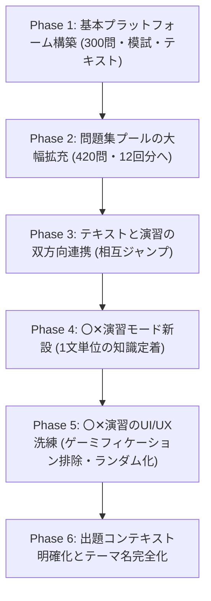

# 【個人開発】危険物取扱者 乙4合格Webアプリを作った話 〜厳選420問・本番模試・〇✕演習・完全網羅テキスト・Vercel自動デプロイまでの全記録〜


---

## はじめに

国家資格「危険物取扱者 乙種第4類（通称：乙4）」は、ガソリンスタンドや化学工場、ビル管理など幅広い産業で必須とされる国内最大規模の人気資格です。

本プロジェクトは、**「市販の紙の問題集を一切使わず、AIが生成・構築したWebサイトだけで乙4の完全合格を達成できるか？」** というコンセプトからスタートした個人開発の実証実験です。

他社の市販問題集や外部Webサイトの焼き直しではなく、**「AI（LLM）が公式シラバスや人間の学習認知特性をゼロベースで分析し、合格に本当に必要な機能要件は何か？」** という独自の見解に基づき、プラットフォーム全体を一貫して設計・進化させてきました。

本記事では、企画・基盤構築から、ユーザーフィードバックを受けて段階的に機能を拡張・洗練させていった**機能追加の全過程を時系列**で記録としてまとめます。

---

## 1. プロダクト概要

- **アプリ名**: 危険物取扱者 乙4 合格マスター
- **公開URL**: [https://otsu4-learning-app-seven.vercel.app/](https://otsu4-learning-app-seven.vercel.app/)
- **リポジトリ**: [GitHub: osaku0521-netizen/otsu4-learning-app](https://github.com/osaku0521-netizen/otsu4-learning-app)

```
┌─────────────────────────────────────────────────────────────┐
│                    乙4合格マスター                           │
├─────────────────┬───────────────────┬───────────────────────┤
│ 一問一答演習    │ 〇✕演習モード     │ 本番想定模擬試験      │
│ (全420問)       │ (全1,476問プール) │ (35問 / 120分)        │
│ ・毎回完全入替  │ ・対象/前提明示   │ ・科目別60%足切り判定 │
│ ・未出題/誤答   │ ・シラバス論点    │ ・全問解説レビュー    │
├─────────────────┴───────────────────┴───────────────────────┤
│ 要点テキスト (全14章) ＆ 用語解説集 (100選)                 │
│ ・問題へのダイレクト演習ボタン ＆ 分数カード数式            │
└─────────────────────────────────────────────────────────────┘
```

---

## 2. 機能追加の過程（時系列ロードマップ）

本アプリケーションは、初期の基本学習機能から、学習効率を極限まで高めるための双方向リンク、新演習モードの追加、そしてユーザーフィードバックに基づく細部のUI/UX改善まで、以下の時系列で継続的なアップデートを行いました。



---

### Phase 1: 基本プラットフォームの構築（初期300問・模試・テキスト）
- **公式シラバス26項目の体系化**:
  消防試験研究センターの出題基準を分析し、法令・物理化学・性質消火の全26サブカテゴリを網羅するデータ構造を設計。
- **5肢択一演習の基盤実装**:
  同じ順番で解くことによる「位置暗記（肢番号の記憶）」を排除するため、問題順だけでなく**選択肢（1〜5）が毎回完全に入れ替わるランダムシャッフル＆正解位置追跡ロジック**を実装。
- **厳格な本番模擬試験（35問 / 120分）**:
  公式比率（法令15問、物理化学10問、性質消火10問）によるランダム出題、120分タイマー、そして**3科目すべてで正答率60%以上が必須となる厳格な足切り判定ロジック**を再現。
- **要点テキスト全14章 & 用語解説100選**:
  外部書籍なしでインプットを完結させるため、オリジナル語呂合わせ付きの体系テキストとインクリメンタル検索付き用語集を実装。
- **モバイルファースト設計**:
  スマホ操作性を高める固定ボトムナビゲーションバーを導入し、学習履歴をLocalStorageへ自動永続化。

---

### Phase 2: 問題集プールの大幅拡充（300問 → 全420問・本番12回分へ）
- **演習密度の最大化**:
  「さらに合格を確実にするため、問題数を増やしたい」という要請を受け、初期の300問から**全420問（法令180問、物理化学120問、性質消火120問）**へ大幅拡充。
- **本番12回分（1,200%）のカバー率**:
  35問の本番模試を完全重複なしで12回実施できる母数を確保。
- **AI逆算設計による頻出度配分**:
  - ★★★（超頻出・落とせない鉄板論点）: **171問 (40.7%)**
  - ★★☆（頻出・合否の分かれ目論点）: **155問 (36.9%)**
  - ★☆☆（重要・安全圏確保の発展論点）: **94問 (22.4%)**
- **シャッフル阻害表現の根絶**:
  選択肢に「上記1〜4のすべてが正しい」などの相対位置依存表現が混入しないようデータ精査を実施し、完全ランダム化に対応。

---

### Phase 3: テキストと演習の双方向連携（インプット＆アウトプットのシームレス化）
- **「解いた直後に復習したい」「読んだ直後に解きたい」への対応**:
  インプットとアウトプットの分断を解消するため、両者のシームレスな双方向ジャンプ機能を開発。
- **問題解説 → 要点テキストへのジャンプ**:
  各問題の解説欄下部に「📖 要点テキストでこの論点を確認（第◯編 第◯章）」ボタンを設置。間違えた直後にワンクリックで該当章のテキストを開けるように改修。
- **要点テキスト → 該当章の問題ダイレクト演習**:
  テキスト各章の末尾に「✍️ この章の問題を解く（◯問）」アクションボタンを常設。章を読み終えた瞬間、その章に関連する問題のみを抽出した演習モードを開始可能に。

---

### Phase 4: 〇✕演習モードの新設（1文単位の高速ドリル）
- **5肢択一の「消去法依存」を打破**:
  「5肢択一だと消去法で正解できてしまい、各選択肢の知識が曖昧なままになる」という課題を解決するため、**〇✕演習モード（Marubatsu Practice Mode）**を新設。
- **約1,470問の命題プール動的生成**:
  420問の全選択肢から、単体で正誤判定が成立する記述を自動抽出し、◯（正しい記述）と✕（誤りの記述）を瞬時に見抜く高速ドリルを構築。
- **専用の大型タッチUI**:
  画面下部に大きな「◯ 正しい」「✕ 誤り」ボタンを配置し、スマホ片手でもリズミカルに周回できるUIを実現。

---

### Phase 5: 〇✕演習のUI/UX洗練（ユーザーフィードバックに基づく最適化）
実際の学習利用から寄せられたフィードバックを受け、不要な要素を削ぎ落として実用的な学習ツールへとブラッシュアップ：
1. **完全ランダム出題の修正**:
   シャッフル関数の代入漏れを修正し、毎回確実にランダムな順序で出題されるように改善。さらに任意のタイミングで出題順を再生成できる**「出題順を再シャッフル」ボタン**を新設。
2. **過剰なゲーミフィケーション表現の撤廃**:
   「瞬殺」「特訓」といった過度なあおり文言や、緊張感を阻害する「ストリークリセット」「🔥 ◯問連続正解」バッジを完全撤去。モード名を落ち着いた**「〇✕演習」**に統一し、実用的な「セッション正答率（正解数 / 解答数）」のみに一本化。
3. **論点テーマのフォントサイズ拡大**:
   画面上部のテーマバッジを太字・高コントラスト背景に拡大し、スマホ画面でも一目で把握可能に改善。
4. **不要なキーボード操作UIの削除**:
   スマホやタブレットのタッチ操作に集中できるよう、画面を占有していたキーボード案内を撤廃。

---

### Phase 6: 出題コンテキスト明確化とテーマ名完全化（直近の改善）
〇✕演習において「問題文が何を聞かれているのか理解できない」「論点テーマが『・・・』で省略されていて分からない」というフィードバックに対し、根本的なロジック改修を実施：
1. **専用の`🎯【対象・前提】`ブロックを常設**:
   - **課題**: 元の5肢択一問題にあった前提（例:「指定数量以上の危険物を運搬する車両に掲げる標識の規格等」）が失われ、単に「0.4m平方以上、白地に赤文字で…」とだけ表示されていたため、何の設備・車両の話なのか主語が不明瞭だった。
   - **解決**: 設問カード上部に**出題の前提・状況（何についての設問か）**を常時明示。
   > **表示例**:
   > **🎯【対象・前提】**: 車両による危険物の運搬において、指定数量以上の危険物を運搬する車両に掲げる「標識」の規格等として：  
   > **【上記の対象について、次の記述は正しいか？ 誤っているか？】**  
   > 「0.4m平方以上、地は白色、文字は赤色で『火気厳禁』と表示する。」
2. **論点テーマの「…」省略を完全撤廃**:
   - **課題**: 従来のロジックで28文字を超えると機械的に24文字＋`…`で切り捨てていたため、「同一の貯蔵所で、ガソリン600リットル、灯油2,…」のように途中で切れてしまっていた。
   - **解決**: 文字数スライスと`…`付与を完全に撤廃。公式シラバス26項目＋主要キーワード（例: `貯蔵・取扱・運搬・移送（標識）`）を組み合わせた完全なテーマ名を表示。全問で省略ゼロ件を達成。

---

## 3. アーキテクチャと技術選定

「勉強したいときに1秒で起動し、依存関係トラブルがなく、将来にわたってメンテフリーで動くこと」を最重要視し、過度なフレームワークを使わない**モダン・ライトウェイト構成**を採用しています。

| レイヤー | 採用技術 | 選定理由 |
| :--- | :--- | :--- |
| **マークアップ** | HTML5 (Semantic) | セーフエリア対応、高速パース、アクセシビリティ |
| **スタイリング** | Tailwind CSS v3 | クラスベースの統一デザイン、レスポンシブユーティリティ |
| **ロジック** | Pure JavaScript (ES2022) | ビルド不要、バンドラ起因の不具合ゼロ、最高速のDOM更新 |
| **Markdown** | Marked.js (ローカル配信) | テキスト教材のMarkdown・表組みレンダリング |
| **データ管理** | UMD形式 JSデータモジュール | Node.jsでの自動検証スクリプトとブラウザ実行の完全共有 |
| **デプロイ** | GitHub + Vercel | Push連動の自動CI/CD、グローバルエッジCDNによる爆速配信 |

---

## 4. 開発中に直面した課題と技術的ブレークスルー

### ① 選択肢シャッフル時の「解説文の肢番号ズレ」問題
- **事象**: 選択肢をFisher-Yates法でシャッフルした際、画面上の正解ボタンは「肢2」になっているのに、解説カードには「【正解: 5】」と元データ由来の固定番号が表示されてしまうズレが発生。
- **解決**: 解説テキスト整形関数 `formatExplanationText` を新設。静的な「【正解: X】」文字列を正規表現でストリップし、動的追跡された現在の表示番号と選択肢本文をバインドして `正解: 肢X 「◯◯◯」` を動的に注入する仕組みに改修。

### ② JavaScriptテンプレート文字列とLaTeX構文の衝突
- **事象**: テキスト教材に `\frac{...}{...}` と記述したところ、JavaScriptのテンプレートリテラル内で `\f` が改ページ文字（Form Feed: `\u000C`）として評価され、数式が文字化けした。
- **解決**: 外部LaTeXライブラリに頼るのではなく、**HTML/CSSで分子・分母を美しくレイアウトしたレスポンシブな「分数ビジュアル数式カード」** を自作。スマホでも数式が崩れず、学習者にとっても直感的に読みやすいUIを実現。

### ③ 〇✕抽出における文脈喪失（主語欠落）の克服
- **事象**: 5肢択一の選択肢を〇✕に変換した際、設問本体が持っていた前提（どの危険物か、どの施設か）が抜け落ち、述語だけの文章になって正誤判定ができなくなった。
- **解決**: 設問文から自然言語処理的に「〜について」「〜として」の前提句を抽出する `cleanPremise` を実装し、設問カード内に独立した「🎯【対象・前提】」ブロックとしてレンダリングする2層構造を採用。

---

## 5. 品質保証：全420問の自動妥当性検証

問題集の価値は**「データの正確性」**にあります。
本プロジェクトでは、Node.jsによる専用テストスイート（`scripts/verify_dataset.js`）を構築し、以下の全項目をプログラムで自動検証しています。

```bash
$ node scripts/verify_dataset.js

========================================================
  乙種第4類 危険物取扱者試験 問題データ検証開始
========================================================

【検証結果サマリー】
- 総問題数: 420 問 (法令: 180問, 物理化学: 120問, 性質消火: 120問)
- 頻出度分布: ★★★: 171問, ★★: 155問, ★: 94問
- エラー件数: 0 件 / 警告件数: 0 件

【合格項目】
  ✓ 全420問の5肢択一フォーマット完全適合 (エラー 0件)
  ✓ 全問題文の重複なし検証（完全一致・類似度チェック）(重複 0件)
  ✓ 乙4範囲外キーワード混入チェック完了 (範囲外 0件)
  ✓ 選択肢シャッフル阻害表現（「上記」「1〜4」等）チェック完了 (違反 0件)
  ✓ 数式文字化け・制御文字・未展開LaTeX混入チェック完了 (エラー 0件)
  ✓ 正解肢インデックスと解説文の正解番号一致チェック完了 (エラー 0件)
  ✓ 全シラバス26サブカテゴリの網羅性チェック完了 (未カバー 0件)
  ✓ 選択肢ランダムシャッフル整合性テスト 3,000回連続成功 (正解追跡エラー 0件)
  ✓ 正解肢の出現頻度均等性 (各肢約20%の均等分布)
  ✓ 問題出題順序ランダムシャッフル検証完了 (欠損なし・重複なし・全問保持)
```

---

## 6. まとめ

本アプリは、単なるWeb問題集にとどまらず、**「本気で一発合格を目指す受験者が、ストレスなく最短距離で知識を定着できる学習体験」** を追求して開発しました。

初期の300問から420問への拡張、双方向ジャンプ機能、そして〇✕演習モードの新設と細部のUI/UX洗練を経て、市販の紙問題集を完全に凌駕する「単体完結型の合格プラットフォーム」として完成に至りました。

乙4を受験されるすべての方のお役に立てれば幸いです！

---
*Developed with pair-programming assistance by Google Antigravity.*
