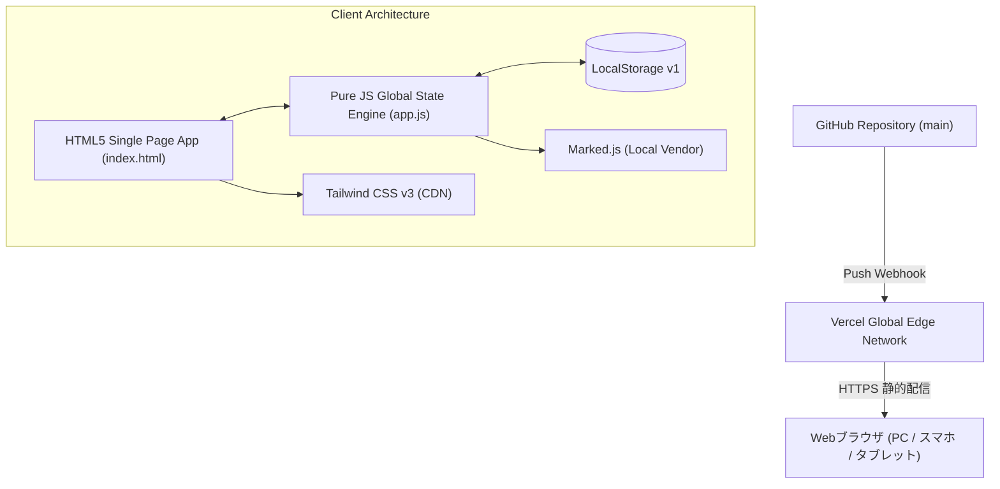

# 危険物取扱者 乙種第4類 学習プラットフォーム システム仕様書

- **文書バージョン**: 1.2.0
- **最終更新日**: 2026年11月6日
- **対象プロダクト**: 乙4合格マスター
- **公開環境**: [https://otsu4-learning-app-seven.vercel.app/](https://otsu4-learning-app-seven.vercel.app/)
- **リポジトリ**: [GitHub: osaku0521-netizen/otsu4-learning-app](https://github.com/osaku0521-netizen/otsu4-learning-app)

---

## 1. システム概要

### 1.1 開発の目的
一般財団法人 消防試験研究センターが実施する「危険物取扱者 乙種第4類」の合格を目指す受験者に対し、以下を無償で提供することを目的とする：
1. 過去問の出題傾向に完全準拠した**全420問のランダム演習機能（5肢択一形式）**
2. 1文単位の論点定着を高速に行う**全1,476問の〇✕演習機能**
3. 本番と同一の時間・問題配分・合否基準を再現した**本番模擬試験機能（計35問）**
4. シラバス全範囲を体系的に学べる**要点テキスト（全14章）**および**用語集（100選）**
5. 問題とテキストの双方向シームレス連携（解説からテキストへジャンプ、テキストから該当章の問題へジャンプ）

### 1.2 コアバリュー
- **選択肢固定暗記の防止**: 5肢択一問題の選択肢完全ランダムシャッフル機能（正解位置追跡）。
- **論点の即時把握**: 〇✕演習における【対象・前提】コンテキスト表示と、省略記号（…）のない公式シラバス準拠テーマ名表示。
- **厳密な本番シミュレーション**: 3科目（法令・物化・性消）それぞれで60%以上の正答を要求する本番同等の合格判定ロジック。
- **端末を選ばない操作性**: スマートフォン（ボトムナビゲーション）およびPC（ワイドヘッダー・サイドバー）への完全レスポンシブ適応。
- **外部依存の極小化**: バンドラ不要のピュア構成、オフライン動作可能なLocalStorage設計。

---

## 2. システムアーキテクチャ

### 2.1 テクノロジースタック


| 区分 | 技術選定 | バージョン/仕様 | 役割 |
| :--- | :--- | :--- | :--- |
| **マークアップ** | HTML5 | Living Standard | セマンティック構造、Viewport、セーフエリア定義 |
| **CSSフレームワーク**| Tailwind CSS | v3.x (CDN) | レスポンシブデザイン、ユーティリティスタイリング |
| **プログラミング言語**| JavaScript | ECMAScript 2022+ | SPA画面遷移、シャッフル、タイマー、DOM制御 |
| **Markdownパーサー** | Marked.js | v15.x (ローカル配置) | テキスト教材および解説文の整形表示 |
| **データ保持** | Web Storage API | LocalStorage | 学習進捗、誤答履歴、ブックマーク、模試成績の永続化 |
| **ホスティング** | Vercel | Production Edge | 静的配信、SSL/TLS暗号化、セキュリティヘッダー付与 |

---

## 3. データ構造仕様

すべての問題・教材データは、ブラウザおよびNode.js（検証スクリプト）の双方で共通利用可能な **UMD（Universal Module Definition）形式** でモジュール化されている。

### 3.1 問題データ仕様（`data/questions_*.js`）
```typescript
interface Question {
  id: string;             // 一意の問題ID (例: "hourei-001", "butsu-025", "seika-075")
  category: string;       // 科目 ("法令" | "物理化学" | "性質消火")
  subCategory: string;    // サブカテゴリ (シラバス準拠、全26種)
  importance: 1 | 2 | 3;  // 過去出題頻出度 (3: 超頻出, 2: 頻出, 1: 重要)
  question: string;       // 問題本文 (客観的消防試験研究センター形式)
  options: string[];      // 5肢択一の選択肢配列 (要素数必ず5、重複なし)
  answerIndex: number;    // 正解インデックス (0〜4)
  explanation: string;    // 正解根拠および各選択肢の正誤解説 (Markdown対応)
}
```

### 3.2 〇✕演習命題プール仕様（自動動的生成）
全420問から自動生成される命題プールデータモデル：
```typescript
interface MarubatsuItem {
  id: string;               // 命題ID (例: "mb-hourei-0134-2")
  sourceQuestionId: string; // 元の5肢択一問題ID
  category: string;         // 科目 ("法令" | "物理化学" | "性質消火")
  subCategory: string;      // サブカテゴリ
  topic: string;            // 論点テーマ (例: "貯蔵・取扱・運搬・移送（標識）")
  premise: string;          // 出題前提・状況 (例: "車両による危険物の運搬において、指定数量以上の危険物を運搬する車両に掲げる「標識」の規格等として")
  importance: 1 | 2 | 3;    // 重要度
  statement: string;        // 判定対象の記述本文
  isCorrect: boolean;       // 正誤真偽値 (true: ◯ 正しい記述, false: ✕ 誤りの記述)
  explanation: string;      // 判定根拠、正解基準および詳細解説
}
```

### 3.3 ユーザー進捗データ仕様（LocalStorage: `otsu4_learning_data_v1`）
```typescript
interface UserData {
  answeredCount: number;
  correctCount: number;
  history: Record<string, { attempts: number; correct: number; lastAnswered: number }>;
  marubatsuHistory: Record<string, { attempts: number; correct: number; lastAnswered: number }>;
  bookmarks: string[];
  mockExams: MockResult[];
}
```

---

## 4. 機能詳細仕様

### 4.1 一問一答・分野別演習（5肢択一モード）
1. **問題プール構成（全420問）**:
   - 法令: 180問
   - 物理化学: 120問
   - 性質消火: 120問
2. **選択肢完全ランダムシャッフル**:
   - 画面描画時にFisher-Yatesアルゴリズムにより肢1〜5の並び順を無作為入替。
   - 元の正解インデックスを安全に追跡し、シャッフル後も正しい肢を判定。
3. **絞り込みフィルター**:
   - 科目別フィルター（全科目 / 法令 / 物理化学 / 性質消火）
   - 頻出度フィルター（★★★ 超頻出 / ★★ 頻出 / ★ 重要）
   - 「未出題のみ演習」「間違えた問題のみ復習」「ブックマーク問題のみ」
4. **要点テキストジャンプ**:
   - 各問の解説エリア下部に、その問題が属するサブカテゴリに対応した要点テキスト章へのジャンプボタンを設置。

### 4.2 〇✕演習モード（Marubatsu Practice Mode）
1. **目的・コンセプト**:
   - 5肢択一の消去法に依存せず、1文単位の知識定着を瞬時に確認する高速ドリル。
2. **自動命題抽出プール（全1,476問）**:
   - 全420問から、明確な主張を持つ記述文を◯（正しい記述）または✕（誤りの記述）として抽出。
   - 数値単体のみの肢など、文脈なしで判定できない肢は自動除外。
3. **出題コンテキストの明確化**:
   - **`🎯【対象・前提】`ブロック**: 元の問題文から出題対象・設備・状況（例:「指定数量以上の危険物を運搬する車両に掲げる標識」等）を抽出し、カード上部に明示。
   - **`📌 論点テーマ`表示**: シラバス26項目＋主要語句を組み合わせ、文字数制限による「…」の切り捨てを一切行わない完全なテーマ名を表示。
4. **完全ランダム出題＆再シャッフル**:
   - 問題順序は常にランダム。
   - 画面上の「出題順を再シャッフル」ボタンにより、いつでも出題順をリフレッシュ可能。
5. **解説とテキスト連携**:
   - 誤りの記述の場合、どこが誤りで何が正しい基準かを明記。
   - 解説下部に該当要点テキスト章への復習リンクを設置。

### 4.3 本番想定模擬試験機能（Mock Exam Mode）
1. **出題構成（計35問）**:
   - 法令: 15問 / 物理化学: 10問 / 性質消火: 10問（全420問のプールから無作為抽出）
2. **タイマー制御**:
   - 120分（7,200秒）カウントダウンタイマー。
   - 残り10分未満で赤色パルス警告アニメーションへ変化。
   - 0秒到達時に自動提出・採点。
3. **ナビゲーターパレット**:
   - 1〜35番の問題解答状況（未解答・解答済・要見直しフラグ）をグリッド表示。
4. **厳密な合否判定ロジック**:
   - 3科目すべてで正答率60%以上（法令9問、物理化学6問、性質消火6問）を達成した場合のみ「合格」。
   - 1科目でも満たない場合は足切り科目を警告表示し「不合格」と判定。
5. **模試結果レビュー＆学習履歴連携**:
   - 模試で解答した全問題の結果は、演習モードの進捗および「間違えた問題のみ」フィルターへ自動連携。

### 4.4 要点テキスト機能（Textbook Mode）
1. **全14章の構成**:
   - 法令5章、物理化学5章、性質消火4章の体系的テキスト。
2. **章別・過去問演習ダイレクト開始**:
   - 各章末尾に「✍️ この章の問題を解く（◯問）」アクションボタンを常設。
   - ワンクリックで該当章の過去問演習（サブカテゴリ絞り込み）へシームレスに遷移。
3. **数式カードコンポーネント**:
   - ボイル・シャルルの法則や倍数計算などの数式をHTML/CSSネイティブで美麗に描画。

### 4.5 用語解説集（Glossary Mode）
1. **重要用語100選収録**:
   - 専門用語、指定数量、法規上の定義、化学用語を網羅。
2. **リアルタイム・インクリメンタル検索**:
   - 入力文字に応じて用語名・よみがな・解説文から即時抽出。
3. **科目別タブ切り替え**:
   - 法令 / 物理化学 / 性質消火のワンタッチ絞り込み。

### 4.6 学習進捗・統計機能（Stats Mode）
1. **演習実績サマリー**:
   - 5肢択一の消化率・累計正答率、科目別進捗バー、ブックマーク数。
   - 〇✕演習の消化問数、セッション正答率。
2. **模試履歴テーブル**:
   - 受験日時、合否結果、総合得点、科目別得点内訳を記録。
3. **データリセット機能**:
   - 二重確認ダイアログ付きでLocalStorageを初期化。

---

## 5. データ妥当性・品質保証仕様

CI/CDおよびメンテナンス時に実行される `scripts/verify_dataset.js` により、以下の項目が常時自動検証される：

1. **基本構造整合性**: 全420問が必須フィールドを保持し、5肢択一形式に合致。
2. **問題重複検証**: 正規化テキスト比較による同一または類似問題の混入ゼロ件。
3. **範囲外問題チェック**: 乙4出題範囲外のキーワード混入ゼロ件。
4. **選択肢シャッフル阻害表現チェック**: 「上記1〜4」「上記のすべて」等の表現混入ゼロ件。
5. **数式文字化けチェック**: LaTeXエスケープ崩れや文字化け混入ゼロ件。
6. **シャッフル整合性シミュレーション**: 3,000回の連続シャッフルテストで正解追跡エラー率0.00%、正解肢の位置均等度（約20%ずつ）を確認。
7. **〇✕演習品質検証**: 命題プールの文字数省略（…）ゼロ件、前提抽出率100%。

---

## 6. ディレクトリ構成

```
otsu4-learning-app/
├── index.html                  # メインSPAエントリーポイント
├── app.js                      # アプリケーションロジック・状態管理
├── style.css                   # カスタムスタイル・数式カード定義
├── README.md                   # 概要・操作マニュアル
├── VERIFICATION_REPORT.md      # データ整合性・妥当性検証レポート
├── data/
│   ├── questions.js            # 全420問統合データローダー
│   ├── questions_hourei.js     # 法令180問
│   ├── questions_butsukagi.js  # 物理化学120問
│   ├── questions_seikashoka.js # 性質消火120問
│   ├── textbook.js             # 要点テキスト全14章
│   └── glossary.js             # 重要用語100選
├── docs/
│   └── SPECIFICATION.md       # 詳細システム仕様書 (本ファイル)
└── scripts/
    └── verify_dataset.js       # CI/CD用データ整合性自動検証スクリプト
```

---
*End of Specification.*
